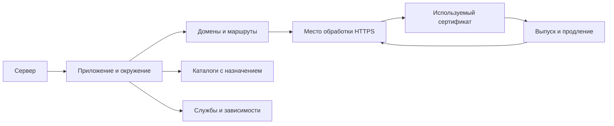

# Карта сервера и приложений

Проектирование от 6 октября 2026 года. Статус: кандидат реализован в checkout, ожидает независимой проверки и рассмотрения.
Фактический контракт и ограничения: [ADR 0081](decisions/0081-linked-server-map.md) и
[руководство](servers.md#связанная-карта-сервера-schema-v30).

Карточка должна помогать человеку понять, что размещено на сервере, как это работает,
что требует внимания и что осталось от прежних проектов. Человек открывает её и может
своими словами объяснить ситуацию, переходя от общего обзора к конкретному объекту.

Основой становятся связанные записи о приложениях, доменах, каталогах, службах и сертификатах.
У каждого состояния есть короткая причина, источник и дата проверки. История хранит прошлые
проверки и изменения; обзор показывает актуальную известную картину.

Все примеры ниже условные. Названия, пути, состояния и сроки в примерах не являются
новыми результатами проверки blue-ant.

## На какие вопросы отвечает карточка

| Вопрос человека | Где находится ответ |
| --- | --- |
| Для чего нужен сервер и что на нём работает? | Обзор с назначением и полным списком приложений |
| Что это за домен и откуда он взялся? | Строка домена, его источник обнаружения и связи |
| Открывается ли сайт и действительно ли он работает здесь? | Раздельные результаты проверки публичного адреса и размещения на сервере |
| Какие каталоги нужны, а какие остались от старых сайтов? | Список каталогов с приложением, ролью, состоянием использования и причиной |
| Для чего нужна эта служба? | Связанные приложения и роль службы, включая общие и фоновые службы |
| Когда закончится сертификат и кто должен его менять? | Карточка сертификата с продлением, применением, ответственным и процедурой |
| Насколько этим сведениям можно доверять? | Даты конкретных проверок и охват последней инвентаризации |

## Что мешает в текущей модели

Текущие сайты содержат свободные списки доменов, путей и служб. Отдельных записей об этих
объектах и проверяемых связей между ними ещё нет. Поэтому технические результаты попадают
в заметки, а человеку приходится самостоятельно восстанавливать схему размещения.

Пять приложений на экране — размер страницы полного ответа server_get по умолчанию.
Dashboard использует этот же ответ. Это ограничивает удобство просмотра, хотя в текущем
формате карточки допускается до 256 приложений. Источники этого поведения:
[MCP](../src/harness/server_mcp.py), [Dashboard](../src/harness/dashboard_servers.py),
[действующий контракт](servers.md#контракт-mcp).

Для новой модели список и подробная карточка получают разные представления. Список содержит
компактные строки всех известных объектов, подробности загружаются при открытии выбранного.
Ограничение размера одного сетевого ответа сохраняется и не определяет число объектов,
которые человек может увидеть.

## Как устроена карточка сервера

В верхней части видны название, назначение, окружение, адреса и краткий паспорт:
ОС, процессор, память, диски, провайдер. Подробности оборудования раскрываются отдельно.
Ёмкость дисков и текущая занятость показываются раздельно, с единицами и датой измерения.
Для процессора указывается модель и число логических CPU, для памяти — общий объём;
доступная сейчас память относится к датированному состоянию ресурсов.

Следом идут три понятных блока:

- **Что размещено.** Приложения с назначением и окружением; количество доменов и связанных каталогов.
- **Что требует внимания.** Конкретные проблемы с переходом к объекту и объяснением последствий.
- **Что ещё не выяснено.** Неизвестное назначение каталогов, отсутствующие связи, непроверенное продление.

Рядом находится строка проверки, например: «Сведения проверены 6 октября, 10:20.
Домены и HTTPS проверены; каталоги исследованы частично». По ней открывается подробный охват.
Числа обозначают известные записи, а не гарантированную полноту обследования сервера.

Основные вкладки: **Обзор · Приложения · Домены · Каталоги · Сертификаты · Службы**.
История, источники, подключение и правила подготовки доступны из раздела «Сведения и история».
Формы редактирования открываются по действию, чтобы обзор оставался читаемым.

Проблемы формулируются человеческим языком. Например: «У магазина истекает сертификат;
продление автоматическое, применение нового файла требует человека». Технические подробности
и источник находятся внутри этой записи. Непонятная строка failed unit сама по себе не становится
утверждением о поломке магазина.

## Связи между объектами

Одна служба может обслуживать несколько приложений. Один сертификат может покрывать несколько
доменов. У приложения может быть несколько каталогов: код, загрузки, старые релизы, резервные
копии. Эти роли сохраняются в связях, чтобы общий nginx или общая база не выглядели забытыми.

Приложение в первой версии — конкретное размещение с окружением на выбранном сервере,
продолжающее существующую запись сайта. Одинаковое название на двух серверах не объединяет
размещения автоматически. Перенос и связь с другим размещением указываются явно.
Связь с репозиторием показывает контекст проекта и не предоставляет доступа к его содержимому.

## Полные списки и управление просмотром

Во всех списках доступны поиск, сортировка, фильтры и постоянная ссылка на выбранный объект.
Поиск и сортировка выполняются по всему набору, включая ещё не загруженные строки.
Фильтр «Все» включает используемые, старые и пока не классифицированные записи.

Для приложений режим **«Все» выбран по умолчанию**: компактный список автоматически загружает
все найденные строки ограниченными порциями. Пока загрузка не завершена, виден прогресс
«Загружено 25 из 188»; ошибка оставляет явное сообщение о неполном списке и кнопку продолжения.
Завершённый список показывает «Все 188 приложений». Это пример интерфейса, а не число приложений blue-ant.

Дополнительно можно выбрать страницы по 25, 50 или 100 строк. Этот выбор служит удобству
пользователя. Аналогичный режим «Все» есть у доменов, каталогов, служб и сертификатов.
Большой список не загружает все подробные редакторы или все источники проверок сразу.
Ограничения ресурсов и ошибки сообщаются явно; последние строки никогда не исчезают молча.

| Список | Основные столбцы | Полезные фильтры и сортировка |
| --- | --- | --- |
| Приложения | Название и назначение; окружение; доступность; использование; требует внимания | Название, окружение, используемые, закрытые, неизвестные, проблемы |
| Домены | Имя; куда ведёт; приложение; открывается ли; HTTPS | Имя, приложение, на этом сервере, через внешний узел, другой сервер, ошибки DNS или HTTPS |
| Каталоги | Путь; приложение и роль; использование; размер; причина состояния | Путь, приложение, роль, используемые, остатки старых сайтов, назначение неизвестно; размер |
| Сертификаты | Где используется; срок; продление; применение; проблема | Дата окончания, ручное продление, ручное применение, неизвестный механизм, ошибки |
| Службы | Название; для чего нужна; связанные приложения; способ запуска; состояние | Название, приложение, общие, фоновые, остановленные, назначение неизвестно |

Размер сортируется как число, срок — как дата. Неизвестные значения явно отделены от нуля
и обычно идут в конце сортировки. Фильтры, порядок и выбор страницы сохраняются в URL.
Числа на вкладках относятся ко всему набору, после фильтра видны и число совпадений, и общий итог.
На узком экране строка превращается в читаемый блок с теми же подписями и действиями.

## Карточка приложения

В начале находятся понятное название, назначение, окружение, ответственный и краткое описание
устройства. Например: «Витрина магазина. nginx принимает запросы, PHP обрабатывает страницы,
данные находятся в общей базе. Загруженные изображения лежат отдельно от кода».
Описание строится по установленным связям; неизвестные части отмечаются в самом предложении.

Ниже видны его домены, каталоги с ролями, службы, несекретные ссылки на зависимости и сертификаты.
Открытие домена или каталога сохраняет возможность вернуться к приложению.
Каждый список показывает все связанные записи и переход к полному списку сервера с этим фильтром.

У приложения раздельно отображаются:

- **Использование:** используется, закрыто, заменено другим размещением, неизвестно.
- **Проверка доступности:** открывается, доступна страница входа, обнаружена ошибка, не проверено.
- **Полнота понимания:** устройство описано, есть конкретные пробелы, проверка устарела.

Ответ HTTP 200 не подтверждает работу всех функций. Для защищённого приложения допустима
формулировка «Страница входа доступна; работу после входа не проверяли».
Название «Работает» используется только в границах указанной проверки с ожидаемым результатом.
Ожидаемый результат может быть известной публичной страницей, страницей входа или проверкой
состояния приложения. Заглушка веб-сервера с кодом 200 не подтверждает доступность нужного сайта.
Остановка процесса, 404 или отсутствие домена не доказывают, что приложение закрыто:
оно может быть внутренним, фоновым или запускаться по расписанию.

## Домены и происхождение списка

Для каждого имени сохраняется, **как оно найдено**: действующая или выключенная конфигурация
nginx/Apache, настройка прокси или контейнера, сертификат, старый импорт, запись оператора.
Источник содержит дату и точную несекретную ссылку, например путь к конфигурации и номер строки.
Несколько источников одного имени объединяются в одной записи и остаются доступны.
Имя из списка SAN сертификата — имя, покрытое сертификатом; связь с работающим сайтом требует
отдельного подтверждения. Шаблон вида *.example.test помечается как шаблон, а не как перечень поддоменов.

Домен проверяется по шагам: известные DNS-ответы A/AAAA/CNAME, публичный HTTPS или HTTP,
перенаправления, локальная конфигурация маршрута и предполагаемое приложение.
DNS здесь проверяет уже найденные имена; он не является способом перечислить все домены сервера.

| Условный домен | Куда ведёт | Проверка | Что это означает |
| --- | --- | --- | --- |
| shop.example.test | На этот сервер, приложение «Магазин» | Открывается, HTTPS без ошибки | Публичный адрес и размещение подтверждены в указанное время |
| www.example.test | Перенаправляет на магазин | Перенаправление работает | Используемый дополнительный адрес |
| cdn.example.test | Через внешний прокси | Публичный адрес доступен, связь с сервером не проверена | Доступность публичного адреса известна; размещение требует проверки |
| old.example.test | DNS ведёт на другой сервер | Здесь осталась конфигурация | Остаток конфигурации; судьба прежнего приложения пока неизвестна |
| unknown.example.test | DNS не найден | Имя найдено в старом импорте | Известно происхождение имени, текущая роль не выяснена |

Если публичный адрес и прямой запрос к серверу дают разные результаты, показываются оба.
Несколько адресов, IPv4/IPv6, разные порты и пути могут иметь разные результаты.
Важные отклонения не скрываются под одним зелёным статусом. При прокси/CDN сертификат посетителя
и сертификат соединения с сервером могут различаться; место обработки HTTPS показывается явно.

## Каталоги и остатки старых сайтов

Инвентаризация касается каталогов размещения: корни сайтов, рабочие каталоги процессов,
тома контейнеров, загрузки, релизы, связанные резервные копии и соседние остатки сайтов
в исследуемых корнях. Охват указывает, какие корни и способы запуска проверены.
Размер отражает метод и дату измерения; общие тома и ссылки не суммируются повторно.

| Состояние | Основание | Формулировка на экране |
| --- | --- | --- |
| Используется | Есть проверенная ссылка из приложения, маршрута, процесса, задания или операторского назначения | «Код магазина; указан в действующей конфигурации» |
| Хранится намеренно | Установлена роль резервной копии, предыдущего релиза, данных или временно выключенного сайта | «Предыдущий релиз; хранится для отката» |
| Возможно остался от старого сайта | Есть признаки прежнего размещения, текущие связи не найдены в проверенном охвате | «Кандидат на очистку; нужно уточнить назначение» |
| Подтверждённый остаток | Закрытие приложения подтверждено, проверены текущие ссылки и причины хранения, остаток признан ненужным | «Остатки закрытой витрины; не очищены» |
| Назначение неизвестно | Недостаточно сведений или проверка неполная | «Не выяснено, к какому сайту относится» |

Раздел **«Остатки старых сайтов»** позволяет ответить на вопрос о мусоре. В нём отдельно видны
подтверждённые остатки и кандидаты на очистку, с путями, размерами, прежним приложением и причиной.
Для подтверждённого остатка сохраняются человек, принявший решение, и дата.
Старые даты файлов, отсутствие HTTP-ответа или незапущенная служба сами по себе такой классификации
не дают. Сохранённое решение сопровождается датой проверки связей; новые ссылки требуют пересмотра.

Классификация не является разрешением удалить каталог. Реальная очистка — отдельная работа
с проверкой зависимостей и сохранности нужных данных, отражаемая в истории после выполнения.

## Службы и фоновые приложения

Служба хранит способ запуска — systemd, контейнер, процесс или расписание — и роль:
веб-сервер, обработчик приложения, база, очередь, почта, продление сертификатов и другое.
Рядом видны связанные приложения и фактическое состояние на момент проверки.
Версия установленного пакета и запущенный экземпляр различаются.

Служба без найденных связей получает «Назначение не выяснено».
Подтверждённо оставшаяся от закрытого приложения служба получает соответствующую причину.
Задание, которое запускается раз в сутки, не считается неисправным из-за отсутствия процесса сейчас.
Общая база или nginx показываются общей зависимостью всех известных потребителей.
Ошибка certbot вызывает вопрос о продлении связанных сертификатов; причинная связь с конкретным
сертификатом устанавливается отдельной проверкой.

## Сертификаты и порядок их обновления

Для человека главный ответ состоит из четырёх частей: **где используется, до какого числа действует,
как продлевается и как новый сертификат попадает в работающий сервис**.
Ответственный и действие при проблеме находятся рядом.

Сертификат рассматривается в трёх состояниях: найденный публичный сертификат в файле,
сертификат, указанный в конфигурации, и сертификат, реально выдаваемый на проверенном адресе.
Совпадение сравнивается по отпечатку сертификата. Новые версии сохраняют связь с прежним
механизмом выпуска, а не создают новую несвязанную «сущность сайта» после каждого продления.
Сверка учитывает конкретные адрес, имя, порт, момент проверки и допустимые версии сертификата.
Это особенно важно для внешнего прокси, нескольких узлов и разных RSA/ECDSA сертификатов.

| Поле карточки | Содержание |
| --- | --- |
| Где используется | Домены, приложения и место обработки HTTPS: этот сервер, внешний прокси, другой узел |
| Покрываемые имена | Имена SAN, включая шаблоны; сопоставление с конкретными адресами |
| Действие | Начало и окончание срока, оставшееся время, когда этот сертификат наблюдался |
| Проверка HTTPS | Совпадение имени, срок, доверие цепочке и результат соединения раздельно |
| Выпуск | Центр сертификации, инструмент или внешний поставщик, место выпуска; известный способ подтверждения домена |
| Продление | Автоматически, вручную или неизвестно; механизм, расписание, последняя попытка и результат |
| Применение | Автоматически, вручную или неизвестно; куда доставляется сертификат, какой сервис его использует и как подхватывает |
| Файлы | Пути публичного сертификата и цепочки; путь или ссылка на приватный ключ без его содержимого |
| Ответственность | Известная ответственная роль или человек; если не установлен, «Не определён» |
| При проблеме | Конкретное следующее действие и проверенная процедура с датой; пробелы процедуры видны |

Настроенная автоматизация и подтверждённая работа различаются. Экран может сообщать
«Автоматическое продление настроено; успешное продление не подтверждено».
Установленного Certbot или успешного завершения задания недостаточно: код успеха renew возможен
и без обновления, а применение нового сертификата имеет отдельный механизм.
Это следует из [руководства Certbot](https://eff-certbot.readthedocs.io/en/stable/using.html#renewing-certificates).
Способы HTTP-01 и DNS-01 описаны в [документации Let’s Encrypt](https://letsencrypt.org/docs/challenge-types/);
карточка переводит известный способ в пояснение, например «Подтверждение через DNS; требуется доступ к управлению зоной».

Для автоматического варианта нужны связанные сведения о конфигурации клиента, расписании,
результате последней попытки, способе доставки/подхвата и проверенном сертификате на адресе.
Если успешного реального продления ещё не было, это видно. Проверочное выполнение не запускается
при открытии карточки: некоторые проверки продления меняют конфигурацию или запускают обработчики.

| Условный случай | Короткое объяснение |
| --- | --- |
| Выпуск и применение автоматические, новый сертификат наблюдался | «Продлевается автоматически; применение подтверждено 5 октября» |
| Сертификат выпущен автоматически, файл для приложения копируют вручную | «Продление автоматическое; требуется вручную установить новый файл» |
| Сертификат присылает поставщик | «Продление и замена вручную; ответственный не определён» |
| Новый файл предназначен для этого адреса, но последующая проверка получает старую версию | «Новый сертификат не применён на проверенном адресе» |
| HTTPS заканчивается на внешнем прокси | «Сертификат посетителя установлен на прокси; механизм его продления не выяснен» |
| Клиент установлен, расписание и история неизвестны | «Механизм продления не подтверждён» |

Процедура ручной замены описывает, откуда получают комплект, какие имена он покрывает,
куда устанавливают файлы, как проверяют согласованность комплекта, как сервис подхватывает
обновление, как сверяют результат снаружи и как возвращают прежний комплект при ошибке.
Неизвестный шаг отмечается прямо. Универсальная команда перезапуска для всех серверов не задаётся;
сохранённая процедура сама ничего не выполняет.

Для внутреннего центра сертификации или самоподписанного сертификата сохраняется ожидаемая
политика доверия. Проверка показывает, для какого клиента и набора доверенных центров получен
результат; внутреннее доверие не приравнивается к доверию обычного публичного браузера.

Предупреждение об окончании срока вычисляется по дате окончания **наблюдавшейся версии**.
Если наблюдение устарело, рядом написано «Возможно уже заменён; нужна проверка».
Сроки предупреждений настраиваются; исходное предложение — за 30, 14 и 7 дней,
с поправкой на известный цикл короткоживущих сертификатов и план продления.
Просроченный сертификат в старом неиспользуемом файле отделён от просроченного сертификата,
который недавно выдавался посетителям. Проверка срока не подразумевает проверку отзыва.

## Актуальность и основания выводов

У состояния всегда есть **значение, причина, источник, время наблюдения и охват проверки**.
Операторское назначение — например «площадка закрыта» — хранится отдельно от технического
наблюдения. Новая проверка не стирает такое назначение; обнаруженное противоречие показывается.

Проверка имеет общий результат: завершена в заявленном охвате, выполнена частично, не удалась.
Отсутствие записи в неполной проверке не превращается в «не используется» и не удаляет объект.
Последнее успешное наблюдение сохраняется с датой; последняя неудачная проверка видна отдельно.
Технически обнаруженное исчезновение объекта также сохраняется в истории и требует оценки роли.

Давность не меняет последний результат на противоположный. Было «Открывался 1 октября» —
станет «Последний результат: открывался; проверка устарела». Это помогает понять и результат,
и его ограничения. Дата одного снимка не заверяет все поля карточки.
Время хранится с часовым поясом; интерфейс показывает локальное время и полный момент по раскрытию.

Начальные интервалы свежести для реализации: доступность, DNS и наблюдаемый HTTPS — 24 часа;
связи из конфигураций и использование каталогов — 7 дней; паспорт машины — 30 дней.
Это параметры политики, видимые пользователю и изменяемые, а не обещание постоянного мониторинга.
После известного изменения соответствующие прежние проверки требуют обновления сразу.

## Как сведения появляются и обновляются

1. Зарегистрированный сервер получает паспорт и понятное назначение. Ранее импортированные
   записи сохраняют происхождение и неизвестную актуальность.
2. По запросу выполняется инвентаризация с объявленным охватом. Сначала выясняются настройки
   размещения и способы запуска, затем связанные имена и каталоги, публичная доступность и HTTPS.
3. Структурированные результаты сопоставляются с существующими объектами по устойчивым
   идентификаторам и явным основаниям. Новые, исчезнувшие и противоречащие записи различаются.
4. Подтверждённые технические сведения обновляют карту. Неоднозначные связи остаются
   «Не выяснено» и попадают в короткий список вопросов оператору.
5. Оператор уточняет смысл: назначение приложения, намеренное хранение, закрытие, ответственного
   за ручную замену. Ему не нужно вручную переписывать сотни доменных строк.
6. Карточки и списки читают одну сохранённую картину. История показывает, что и когда изменилось.

Нажатие «Обновить экран» перечитывает сохранённые данные. Отдельное действие «Проверить сервер»
обозначает новую удалённую работу, её охват и состояние выполнения. В первой реализации такая
работа выполняется агентом через имеющиеся инструменты по запросу человека; Harness хранит
результаты и не становится универсальным исполнителем SSH. Периодические проверки и уведомления
настраиваются отдельным запросом. Неполная проверка имеет видимый список непроверенных областей.

Содержание конфигураций, имена файлов и импортированные заметки считаются данными,
а не инструкциями для агента. В карте сохраняются только допустимые несекретные поля и ссылки
на источники. Ключи, токены, пароли, сырые конфигурации и бизнес-данные в реестр не попадают.

## Как перенести сведения о blue-ant

В предоставленном снимке упомянуты 95 nginx vhost и 188 имён из прежних источников,
а также отдельные проверки DNS и HTTPS. Эти числа относятся к разным объектам и снимкам.
Из 188 имён нельзя получить число приложений без установления связей.

Первый перенос сохраняет эти сведения как прежние наблюдения. Домены, перечисленные только
в исходном материале, получают соответствующий источник и неизвестное текущее состояние.
Затем проверка существующих настроек связывает реальные приложения, адреса, каталоги,
службы и сертификаты. Остатки прежних размещений выделяются с основаниями.
Упоминание failed certbot становится поводом выяснить механизм продления конкретных сертификатов.
Старые пути и службы не объявляются мусором по одному упоминанию.

Итоговая карточка должна объяснять: какие приложения известны, какие имена действительно
ведут на них, что настроено здесь, что обслуживается снаружи, какие файлы используются,
что сохранилось от закрытых площадок и какие части ещё требуют исследования.

## Последовательность реализации

| Этап | Результат, который можно проверить |
| --- | --- |
| Полные списки | Все существующие приложения видны компактно; режим «Все», поиск и сортировка охватывают весь набор |
| Связанные записи | Домены, каталоги и службы получают собственные записи, связи с приложениями, основания и даты; карточка приложения показывает устройство |
| Сертификаты | Видны срок, место использования, выпуск, продление, применение, ответственный и процедура; учитываются общие сертификаты и внешний прокси |
| Обновление картины | Структурированная инвентаризация, охват, частичные результаты, противоречия, операторское уточнение и история изменений |
| Проверка понятности | Человек объясняет устройство выбранного сервера по карточке, находя ответы на вопросы из первого раздела |

Все эти этапы входят в согласованную модель. До появления связей старые значения остаются
видимыми с обозначенным происхождением. Архитектура хранения и перехода описана в
[предлагаемом ADR 0081](decisions/0081-linked-server-map.md).

## Сценарии приёмки

- 188 доменных имён доступны полностью: поиск находит последнее, сортировка применяется ко всему
  списку, итог не зависит от числа загруженных порций. Отдельно проверяются 6, 256 и 1000 приложений.
- Один сайт с несколькими именами показан одним размещением с несколькими доменами;
  неподтверждённые связи не возникают из сходства названий.
- Домен работает на другом сервере, но старая конфигурация осталась здесь: видны оба факта.
- IPv4 работает, IPv6 или один из адресов возвращает ошибку: отклонение видно.
- Защищённый сайт показывает рабочую страницу входа без заявления о проверенных бизнес-функциях.
- Старый релиз для отката и общий том остаются нужными; забытая витрина видна с причиной,
  неизвестный каталог не получает ярлык мусора.
- Сертификат продлён автоматически, но вручную применяется в контейнере: ручной шаг заметен.
- Новый файл и сертификат посетителя различаются; общий сертификат показывает все связанные приложения.
- После частичной проверки прежние записи не пропадают; после конфликта данные и черновики сохраняются.
- Старое наблюдение срока сертификата не выдаётся за сегодняшнюю проверку HTTPS.
- По карточке выбранного сервера человек может ответить, что работает, что осталось от старых сайтов,
  что надо проверить и кто меняет сертификаты, без чтения исходного технического отчёта.
